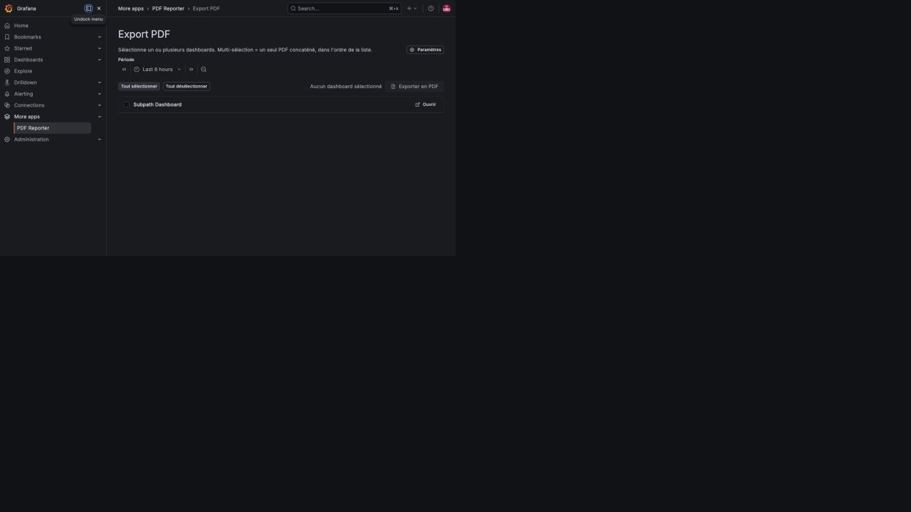

# Grafana PDF Reporter

Grafana OSS app plugin that exports one or more dashboards to a branded PDF.
It provides a cover page, automatic dashboard orientation, native Grafana
time ranges, and a live cover preview.



## Features

- Dashboard selection from the Grafana app page, with multi-dashboard bundles.
- Cmd+K command-palette action for the current dashboard.
- A4 landscape, square, or portrait page chosen from the dashboard layout.
- Cover branding: title, subtitle, footer, accent color, logo, and background.
- Lightweight image-generation prompt designed to leave a calm empty center and
  avoid generated text or logos.
- French/English UI and Grafana light/dark theme support.
- Grafana subpath support (`GF_SERVER_SERVE_FROM_SUB_PATH=true`).

Detailed scenarios are documented in [Use cases](https://github.com/VincentGourbin/grafana-pdf-reporter/blob/main/docs/USE-CASES.md), including
operations reports, incident reviews, multi-dashboard bundles, enterprise
PKI, and GitOps deployments.

## Requirements

- Grafana OSS **12.4.2 or later**. Compatibility is tested on Grafana
  **12.4.2** and **13.1.0**.
- On Grafana 12.4.2, the legacy renderer can retain the time-picker controls
  in the captured dashboard image even when the native hide-time-picker URL
  flag is sent. Grafana 13.1.0 hides those controls as expected; this is an
  upstream renderer difference and does not affect dashboard data or access
  control.
- Grafana image rendering must be configured and working. The plugin calls
  Grafana's native `/render/d/<uid>` endpoint and does not contact Chromium or
  the renderer directly.
- An account for the plugin, which needs `users.permissions:read` to check each
  caller's access. See [Plugin account](#plugin-account).

For a remote renderer configure Grafana `[rendering] server_url`,
`callback_url`, and a non-default `renderer_token`. Grafana 13.x refuses to
start rendering with the default token. The current official
`grafana/grafana-image-renderer` image listens on port `8081`.

## Architecture

```text
Browser ──authenticated Grafana session──► PDF Reporter resource handler
                                             │
                                             ├─ GET /api/dashboards/uid/<uid>
                                             └─ GET /render/d/<uid> ──► Grafana rendering
                                                                         │
                                                                         └─ image-renderer
```

The service-account token is used for metadata and native rendering. Grafana
resource calls do not forward caller cookies or authorization headers on the
tested 12.4.2 and 13.1.0 versions, so the plugin enforces a minimum Grafana
role (`Viewer` by default). Scope the service account to the dashboards that
the deployment is allowed to export.

## Installation

### Grafana Catalog

Install and enable **PDF Reporter** from Grafana Administration → Plugins,
then configure the app instance as described below.

## Configuration

Configure the app instance as Grafana Admin. Sensitive values belong in
`secureJsonData`, which Grafana encrypts in its database.

### Plugin account

The plugin reads dashboards, renders them, and reads the caller's permissions
with one account. Exports fail with HTTP 502 until that account can read
permissions. Choose one of the following:

- **Managed account (recommended).** Enable the `externalServiceAccounts`
  feature toggle and set `managed_service_accounts_enabled = true` under
  `[auth]`. Grafana then creates an account holding only the permissions declared
  by the plugin, and `grafanaSAToken` is not needed. This feature is in public
  preview and supports a single organization.
- **Org Admin token.** Create a service account with the Admin role and set its
  token as `grafanaSAToken`. Only an Org Admin holds `users.permissions:read` by
  default on Grafana OSS, so a Viewer or Editor token is not enough. Treat this
  token as an administrator credential.

If both are available, `grafanaSAToken` is used: the managed account exists in
one organization only, so other organizations need their own token.

| Field | Storage | Description |
|---|---|---|
| `grafanaSAToken` | `secureJsonData` | Org Admin service-account token; not needed with the managed account. See [Plugin account](#plugin-account). |
| `grafanaURL` | `jsonData` | Grafana URL reachable from the plugin backend; default `http://localhost:3000`. |
| `minRole` | `jsonData` | Minimum caller role: `Viewer` (default), `Editor`, or `Admin`. |
| `tlsSkipVerify` | `jsonData` | Default `false`; set `true` only for explicitly accepted self-signed certificates. |
| `tlsCACert` | `jsonData` | Optional PEM CA certificate for private enterprise PKI. |
| `viewportWidth` | `jsonData` | Optional render width override (advanced; the render height always auto-fits the dashboard's actual content). |
| `memLimitMiB` | `jsonData` | Optional Go heap limit in MiB for this plugin instance; `0` keeps the default. |
| `renderTimeoutSec` | `jsonData` | Optional render timeout. |
| `deviceScaleFactor` | `jsonData` | Optional image scale; higher values use more memory. |
| `coverBrandTitle` / `coverBrandSubtitle` | `jsonData` | Cover branding text. |
| `coverFooterLeft` / `coverFooterRight` | `jsonData` | Cover footer text. |
| `coverAccentHex` | `jsonData` | Cover accent color, for example `#10B981`. |
| `coverLogoDataURL` | `jsonData` | PNG/JPEG data URL, max 200 KiB. |
| `coverBackgroundDataURL` | `jsonData` | JPEG/PNG data URL, max 800 KiB; JPEG is recommended. |

### Provisioning-as-code

```yaml
apps:
  - type: vincentgourbin-pdfreporter-app
    org_id: 1
    disabled: false
    jsonData:
      grafanaURL: http://localhost:3000
      minRole: Viewer
      tlsSkipVerify: false
    secureJsonData:
      grafanaSAToken: $PDF_REPORTER_SA_TOKEN
```

Use the provisioning mechanism and secret substitution supported by your
Grafana deployment. Never commit the service-account token.

## Security model

- Grafana authenticates the caller and forwards a signed identity token to the
  plugin backend. The plugin verifies its signature against Grafana's public
  signing keys.
- Before rendering anything, the plugin confirms the caller holds
  `dashboards:read` on every requested dashboard, directly or through its folder
  or a parent folder. If any dashboard is refused, the whole export returns
  HTTP 403 and nothing is rendered. Unknown dashboards get the same answer.
- Callers without a signed identity, such as anonymous users, cannot export.
- `minRole` is an additional gate: callers below it are refused first.
- The plugin account performs the render, so the PDF shows what that account
  sees once the caller's access is confirmed. Data-source permissions narrower
  than dashboard access, available on Grafana Enterprise, are not applied to the
  PDF. Prefer the
  [managed account](#plugin-account), which holds fewer permissions than an Org
  Admin token.
- TLS verification is strict by default. Use `tlsCACert` for enterprise CAs;
  use `tlsSkipVerify` only as a documented exception for a self-signed setup.
- At most two complete PDF exports run concurrently. This limits Chromium and
  plugin memory pressure; saturated requests return HTTP 429 after 30 seconds.
- Cover images are stored in Grafana `jsonData`, which is visible to users who
  can inspect the app configuration. Do not put secrets in branding fields.
- The service-account token is read from `secureJsonData` and is never written
  to plugin logs.

See the [enterprise deployment guide](https://github.com/VincentGourbin/grafana-pdf-reporter/blob/main/docs/DEPLOYMENT-ENTERPRISE.md) for a
conservative production baseline and [SECURITY.md](https://github.com/VincentGourbin/grafana-pdf-reporter/blob/main/SECURITY.md) for reporting
vulnerabilities.

## Troubleshooting

- **Export returns HTTP 403**: the caller cannot read one of the selected
  dashboards, or is below `minRole`. Check the dashboard and folder permissions.
- **Export returns HTTP 502 with "access check failed"**: the plugin account
  cannot read permissions. See [Plugin account](#plugin-account); the plugin
  logs give the exact Grafana answer.
- **Export fails with "rendered image too large"**: the dashboard exceeds 64
  million pixels at the current scale. Lower `deviceScaleFactor` or split it.
- **PDF shows the login page**: configure Grafana native image rendering and
  verify `/render/d/<uid>` works with the service-account token. Remove legacy
  renderer `BROWSER_HEADER` configuration after migrating.
- **Grafana 13.x refuses to start rendering**: set a non-default
  `[rendering] renderer_token` and use the matching renderer token.
- **Renderer connection fails**: the current official renderer uses port
  `8081`; check `server_url`, `callback_url`, network reachability, and the
  token on both sides.
- **HTTPS certificate error**: install the enterprise CA through `tlsCACert`,
  or explicitly set `tlsSkipVerify: true` only for a controlled self-signed
  endpoint.
- **Plugin does not load**: use a valid signature. Unsigned loading is for
  development only. Private signatures are bound to their configured root URLs.
- **Subpath deployment fails**: set Grafana's root URL and
  `GF_SERVER_SERVE_FROM_SUB_PATH=true`, then verify the plugin is accessed
  through the same `/grafana/` prefix.

## Compatibility

| Grafana | Status |
|---|---|
| 12.4.2 | Tested: plugin load, UI, command palette, APIs, native rendering |
| 13.1.0 | Tested: plugin load, UI, command palette, APIs, native rendering |

The legacy dashboard layout uses `gridPos` for automatic orientation. If a
future Grafana dashboard-v2 layout omits it, the plugin falls back safely to
landscape orientation.

## Testing this plugin

A disposable Docker environment with sample dashboards is available for
evaluation and review — see [docs/TESTING.md](https://github.com/VincentGourbin/grafana-pdf-reporter/blob/main/docs/TESTING.md).

## License

Apache-2.0. See [LICENSE](https://github.com/VincentGourbin/grafana-pdf-reporter/blob/main/LICENSE).
